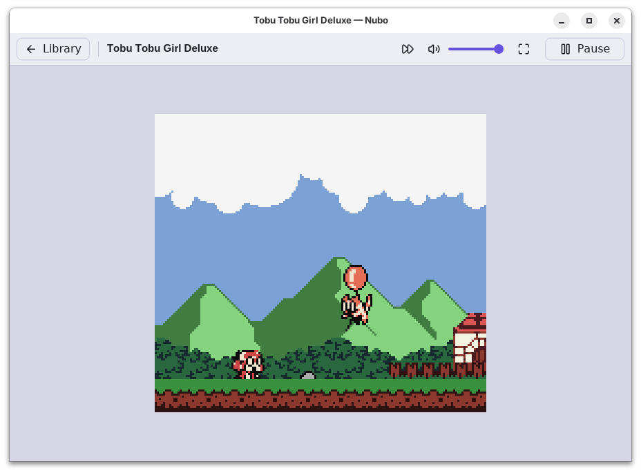

  

<h1 align="center">Nubo</h1>

  A Game Boy and Game Boy Color emulator that plays games as the real hardware does, on your computer or in the browser.

  
  
  
  

  

Nubo runs Game Boy, Game Boy Color and Super Game Boy games with timing exact to the cycle, so even games and demos that rely on the hardware's quirks look and sound right. It passes 261 of the 264 tests of the [GB Emulator Shootout](https://gbdev.io/GBEmulatorShootout/), more than any emulator in its published table (see [Accuracy](#accuracy)). It comes with a game library, save states, cheats and controller support, and also runs as a [RetroArch](#retroarch-core) core.

## Download

| Platform | Download |
| -------- | -------- |
| Windows | [Installer](https://github.com/mschoenm/nubo/releases/latest/download/Nubo-windows-x64.msi) · [Zip](https://github.com/mschoenm/nubo/releases/latest/download/Nubo-windows-x64.zip) (runs without installing) |
| Linux | [Flatpak for x86_64](https://github.com/mschoenm/nubo/releases/latest/download/Nubo-linux-x86_64.flatpak) (most PCs) · [Flatpak for ARM](https://github.com/mschoenm/nubo/releases/latest/download/Nubo-linux-aarch64.flatpak) |
| macOS | No download yet: [build it yourself](BUILDING.md#macos) |
| Browser | [Play in the browser](https://mschoenm.github.io/nubo/), nothing to install (opens one game at a time; the library, save states, cheats and screenshots need the desktop app) |
| RetroArch | The core's zips for Windows, Linux and macOS are in each [release](https://github.com/mschoenm/nubo/releases/latest) (see [RetroArch Core](#retroarch-core)) |

- **Windows:** the files aren't signed yet, so SmartScreen may warn the first time: choose More info and then Run anyway.
- **Linux:** open the `.flatpak` file with your software center to install it, or run `flatpak install --user Nubo-linux-x86_64.flatpak`. The computer needs Flatpak; the runtime Nubo needs is downloaded from Flathub the first time.
- **Newest version:** the [nightly build](https://github.com/mschoenm/nubo/releases/tag/nightly) has the newest changes that passed every check.

Nubo doesn't come with any games. Use games you own, or try free homebrew games such as [Tobu Tobu Girl Deluxe](https://tangramgames.itch.io/tobu-tobu-girl-deluxe), [µCity](https://github.com/AntonioND/ucity) or the ones on [Homebrew Hub](https://hh.gbdev.io).

## Features

- **Accurate:** the processor, graphics and sound are emulated cycle by cycle, so mid-screen effects, timing tricks and sound all match the hardware.
- **Every model:** from the first Game Boy to the Game Boy Advance running Game Boy games (DMG-0, DMG, Pocket, Super Game Boy 1 and 2, every Game Boy Color revision and AGB). Nubo picks the right one for each game, or you pick it yourself.
- **Super Game Boy:**
  - the game's own colors and borders, and up to four players, each controller playing its own;
  - games made for it start on it by itself (unless they are made for the Game Boy Color too);
  - Nubo's own border for games that bring none, whose clouds start drifting when you leave the controller alone for seven minutes.
- **A game library** built from your ROM folders (with or without subfolders), with search, recently played games, and each game's title screen or downloaded box art.
- **Save states** with pictures, quick save and load, and picking up where you left off.
- **Fast forward**, fullscreen, screenshots and volume control.
- **Your controls:** keyboard and controller buttons you can change, and menus you can use with a controller.
- **Cheats:** GameShark and Game Genie codes, kept per game.
- **Colors:** light and dark themes that can follow your system, and gray, green or Pocket colors for Game Boy games. The pause menu's Super Game Boy page picks those games' colors (the game's, gray, green, Pocket or your own, with a color editor) and border (the game's, Nubo's or none).
- **In-game saves** for cartridges with a battery, kept on your computer (or in the browser's storage).
- **Cartridges:** ROM only, ROM and RAM, MBC1, MBC2, MBC3 (with its clock, and the MBC30 of 4 MB games), MBC5 (with rumble) and HuC1. Games load from `.gb`, `.gbc` and `.zip` files.

## Not Supported Yet

- A download for macOS (you can [build it](BUILDING.md#macos)), and Android or iOS.
- Linking two games with the link cable.
- The Pocket Camera, and the cartridges with an MBC6, MBC7 (Kirby Tilt 'n' Tumble), MMM01, HuC3 or TAMA5.

## Playing

Open a single game, or add your ROM folders under Settings > Library to fill the library. The default controls are below; all of them can be changed under Settings > Controls.

| Keyboard | Game Boy |
| -------- | -------- |
| Arrow keys | D-pad |
| Z | A |
| X | B |
| Enter | Start |
| Space | Select |

| Keyboard | Does |
| -------- | ---- |
| Esc | Pause menu |
| Tab (hold) | Fast forward |
| F5 / F8 | Quick save / quick load |
| F11 | Fullscreen |
| F12 | Screenshot |

On a controller, the D-pad or left stick moves, the right face button (B on Xbox, ○ on PlayStation) is A, the bottom face button (A on Xbox, ✕ on PlayStation) is B, L1 opens the pause menu and R1 fast forwards.

### Where Your Games' Saves Are

Everything Nubo keeps (settings, the library, in-game saves, save states, cheats and their pictures) is in your user data folder:

| System | Folder |
| ------ | ------ |
| Windows | `%APPDATA%\Nubo` |
| macOS | `~/Library/Application Support/Nubo` |
| Linux (Flatpak) | `~/.var/app/io.github.mschoenm.nubo/` |
| Linux (built yourself) | `~/.local/share/nubo` (or `$XDG_DATA_HOME/nubo`), with the settings in `~/.config/nubo` |

Screenshots go to your Pictures folder, in `Pictures/Nubo`.

### Installing and Removing

- **Windows:** the installer installs Nubo for your user, without administrator rights, with a Start menu entry; it can also offer Nubo for opening `.gb` and `.gbc` files and add a desktop shortcut. Running a newer installer updates Nubo and keeps those choices. Uninstall Nubo from Settings > Apps, like any app. To install without questions from a script, run `msiexec /i Nubo-windows-x64.msi /qn`, adding `ASSOCIATE_FILES=0` (don't offer Nubo for ROMs) or `DESKTOP_SHORTCUT=1` (add a desktop shortcut); `/passive` shows only a progress bar.
- **Linux:** the Flatpak adds Nubo to your app grid; it can read ROM folders in your home folder and on external drives. Start it from a terminal with `flatpak run io.github.mschoenm.nubo`, and remove it with `flatpak uninstall --user io.github.mschoenm.nubo` or your software center.

## RetroArch Core

Nubo also runs in [RetroArch](https://www.retroarch.com/) and other frontends of the libretro interface. RetroArch then brings what it has for every core: save state slots, rewind, run-ahead, netplay, shaders, RetroAchievements, its cheat list, recording and button remapping. The core is experimental and not in RetroArch's own core downloader yet, so it is installed by hand:

1. Download the zip for your system (`Nubo-libretro-<system>.zip`) from a [release](https://github.com/mschoenm/nubo/releases/latest) or the [nightly build](https://github.com/mschoenm/nubo/releases/tag/nightly).
2. Copy `nubo_libretro.so` (Linux), `nubo_libretro.dll` (Windows) or `nubo_libretro.dylib` (macOS) into RetroArch's `cores` folder, and `nubo_libretro.info` into its `info` folder. Settings > Directory in RetroArch shows where they are. Without the info file RetroArch doesn't know which games the core runs, and turns off rewind and run-ahead for it.
3. Load a `.gb` or `.gbc` game with Load Core > Nubo, or pick "Nintendo - Game Boy / Color (Nubo)" for a playlist.

What it does:

- **Games:** every cartridge the app runs, with the boot ROMs built in, so no BIOS files are needed. The core options pick the model (automatic, or any model from DMG-0 to AGB), the colors of Game Boy games (gray, green or Pocket), the colors and border of Super Game Boy games (the game's own, or a palette and Nubo's border, as the Super Game Boy's menu picks them) and the cartridge clock; the model and the clock take effect when the game is restarted.
- **Saves:** RetroArch keeps in-game saves as `.srm` and `.rtc` files. The `.srm` is the same raw cartridge RAM as the app's `.sav` file, and the `.rtc` the same clock file, so saves move between the app and RetroArch by renaming them.
- **Save states, rewind, run-ahead and netplay**, with states of one fixed size. A state saved with the cartridge clock on real time goes on with the time it is loaded at; for netplay with games that have a clock, such as Pokémon Gold, set the Cartridge clock option to Emulated time on every player's side. The Super Game Boy colors and border options are the player's own: loading a state keeps them, and each netplay player sees their own.
- **Cheats:** RetroArch's cheat list, with Game Genie and GameShark codes, several in one cheat joined with `+`, and cheats that RetroArch applies itself by writing to memory (its cheat files' RetroArch handler and its cheat search).
- **RetroAchievements:** the memory maps achievements read, laid out as RetroAchievements expects a Game Boy and a Game Boy Color. RetroArch's own memory tools see the same memory, and what they write reaches the game: work RAM, high RAM, video RAM, sprite memory and cartridge RAM (a change to battery-backed RAM is saved too). The hardware registers are read-only.
- **Rumble** on rumble cartridges such as Pokémon Pinball.

The Linux cores need glibc 2.34 or newer (Ubuntu 22.04, Debian 12 or later); the macOS core runs on Apple silicon and Intel Macs. There is no Android or iOS core yet.

## Accuracy

Nubo is checked against thousands of test ROMs: small programs written to test one detail of the hardware each, against what real consoles do. Every pull request runs them all, and fails if a test that passed stops passing.

- **[GB Emulator Shootout](https://gbdev.io/GBEmulatorShootout/):** counted on the 264 tests of its table published on 2026-06-04, Nubo passes 261, which would put it first (the leader, DocBoy, passes 255). The other three only report information.
- **The processor:** Nubo passes all [JSON CPU tests](https://github.com/adtennant/GameboyCPUTests), which check every instruction cycle by cycle.
- **Speed:** being exact costs speed, but on one core of a shared 2.1 GHz cloud server Nubo still runs games about 50 to 125 times as fast as a real Game Boy, and 3 to 6 times as fast as SameBoy, which also draws the screen dot by dot ([the comparison](docs/EMULATOR_COMPARISON.md)).

### Test ROMs

`cargo test-roms` downloads a pinned release of the [Game Boy test ROM collection](https://github.com/c-sp/game-boy-test-roms), plus the test ROMs and reference screenshots of the [GB Emulator Shootout](https://gbdev.io/GBEmulatorShootout/) that the collection doesn't have in the same version, and runs each test ROM on the hardware models it targets: DMG-0, DMG, MGB, SGB and SGB2 (monochrome) and CGB-0 to CGB-E and AGB (color). The Shootout's own tests also run the way the Shootout judges them, on a DMG, an SGB or a CGB-E with its screenshot comparison, and the runner compares the result with the Shootout's published table. The tests that pass are listed in [tools/nubo-test-rom-runner/passing.txt](tools/nubo-test-rom-runner/passing.txt), and the ones that still fail, and why, in [tools/nubo-test-rom-runner/FAILING_TESTS.md](tools/nubo-test-rom-runner/FAILING_TESTS.md). What still has to happen before Nubo can claim to be the most accurate Game Boy emulator is planned in [docs/ACCURACY_PLAN.md](docs/ACCURACY_PLAN.md).

| Suite | Monochrome | Color |
| ----- | ---------- | ----- |
| [Blargg's tests](https://github.com/retrio/gb-test-roms) | 7/7 | 7/7 |
| [Mooneye Test Suite](https://github.com/Gekkio/mooneye-test-suite) | 137/138 | 97/97 |
| [Wilbert Pol's Mooneye tests](https://github.com/wilbertpol/mooneye-gb) | 153/154 | 107/107 |
| [dmg-acid2](https://github.com/mattcurrie/dmg-acid2) | 1/1 | 1/1 |
| [cgb-acid2](https://github.com/mattcurrie/cgb-acid2) | | 1/1 |
| [cgb-acid-hell](https://github.com/mattcurrie/cgb-acid-hell) | | 1/1 |
| [Mealybug Tearoom Tests](https://github.com/mattcurrie/mealybug-tearoom-tests) | 24/24 | 69/71 |
| [SameSuite](https://github.com/LIJI32/SameSuite) | 4/4 | 82/82 |
| [Gambatte](https://github.com/pokemon-speedrunning/gambatte-core) | 1865/1873 | 3340/3352 |
| [GBMicrotest](https://github.com/aappleby/GBMicrotest) | 480/482 | |
| [AGE](https://github.com/c-sp/age-test-roms) | 12/14 | 102/105 |
| [rtc3test](https://github.com/aaaaaa123456789/rtc3test) | 3/3 | 3/3 |
| [Bully](https://github.com/Hacktix/BullyGB) | | 1/1 |
| [Strikethrough](https://github.com/Hacktix/strikethrough.gb) | 1/1 | 1/1 |
| [Scribbltests](https://github.com/Hacktix/scribbltests) | 5/5 | 5/5 |
| [TurtleTests](https://github.com/Powerlated/TurtleTests) | 2/2 | 2/2 |
| [little-things-gb](https://github.com/pinobatch/little-things-gb) | 2/2 | 2/2 |
| [MBC3 Tester](https://github.com/EricKirschenmann/MBC3-Tester-gb) | 1/1 | 1/1 |
| [daid's tests](https://github.com/gbdev/GBEmulatorShootout/tree/main/testroms/daid) | 2/2 | 6/6 |
| [CasualPokePlayer's MBC3 and Super Game Boy tests](https://github.com/gbdev/GBEmulatorShootout/tree/main/testroms/cpp) | 5/5 | |
| [GB Emulator Shootout](https://github.com/gbdev/GBEmulatorShootout), judged as the Shootout judges them | 168/168 | 93/93 |

These aren't run, because nothing can check them automatically or they need hardware Nubo doesn't emulate:

- Mealybug Tearoom's `mbc3_rtc` and Scribbltests' `fairylake`, `winpos` and manual `statcount`: they have no reference screenshot.
- The shootout's `which.gb` and `rom_and_ram.gb`: they report what they find instead of passing or failing.
- Wilbert Pol's `logic-analysis` ROMs and Mooneye's `utils`: they are for logic analyzers and hardware dumps.
- The collection's Bully on monochrome models: real DMGs fail it too. (The Shootout runs its own build of Bully on DMG, which Nubo passes.)
- CasualPokePlayer's `gb-camera-test` and `open-bus-ss-test`: the first needs the Pocket Camera, the second only has a photo of real hardware to compare with.
- The [144p Test Suite](https://github.com/pinobatch/240p-test-mini) (judged by eye) and [AntonioND's GBC hardware tests](https://github.com/AntonioND/gbc-hw-tests) (results recorded from real consoles, which would need a checker of their own).

## Building and Contributing

Nubo is written in Rust, and only needs a [Rust toolchain](https://rustup.rs) to build: `cargo play` builds and runs the desktop app, and `cargo xtask web` the browser version. [BUILDING.md](BUILDING.md) has the other commands, how to make the packages, the tests and where the code is. Pull requests are welcome; [AGENTS.md](AGENTS.md) has the project's rules and the checks to run before you push.

## Credits

Nubo started as a fork of [Retro Boy](https://github.com/smparsons/retroboy) by Samuel Parsons, who wrote the original emulator, its web frontend and its logo ([play the original](https://smparsons.github.io/retroboy)). Nubo builds on that work.

Much of its accuracy comes from other people's research and code:

- [SameBoy](https://github.com/LIJI32/SameBoy) by Lior Halphon: the APU channel timing, the mode 3 pixel pipeline, the OAM corruption bug, the OAM DMA bus conflicts, the CGB speed switch timing, STOP mode, the PPU register write timing, the serial clock, the MBC3's banks and clock latch and the Super Game Boy's commands, colors and borders are ported from SameBoy, and the Game Boy Color boot ROM is a modified version of SameBoy's (Expat License, see [NOTICE](NOTICE)). SameBoy was also the reference for halt timing, the order of the hardware models, GameShark codes and many smaller hardware quirks.
- [Bootix](https://github.com/Hacktix/Bootix) by Hacktix: the boot ROM of the monochrome models is a modified version of Bootix (CC0).
- [Gambatte](https://github.com/pokemon-speedrunning/gambatte-core) by sinamas: a reference for the timing of double speed and the window, worked out by running the same test ROMs in Gambatte and Nubo and studying where they differ. Gambatte's GPL-2.0-only license can't be combined with Nubo's, so no code comes from it.
- [Pan Docs](https://gbdev.io/pandocs/) and the [gbdev](https://gbdev.io) community: the reference for nearly every hardware register.
- [SonoSooS's Game Boy CPU notes](https://gist.github.com/SonoSooS/c0055300670d678b5ae8433e20bea595): the fetch, decode and execute overlap of the CPU.
- The authors of the test ROMs that keep the emulator honest, linked in the [Test ROMs](#test-roms) table: Blargg, Joonas Javanainen (Mooneye), Wilbert Pol, Matt Currie (the acid tests and Mealybug Tearoom), Lior Halphon (SameSuite), sinamas (Gambatte), Austin Appleby (GBMicrotest), c-sp (AGE, and the [Game Boy test ROM collection](https://github.com/c-sp/game-boy-test-roms) that packages them), ax6 (rtc3test), Hacktix (Bully, Strikethrough and Scribbltests), Brian Jia (TurtleTests), Damian Yerrick (little-things-gb), Eric Kirschenmann (MBC3 Tester), daid, CasualPokePlayer and the gbdev community (the GB Emulator Shootout), and adtennant (the [JSON CPU tests](https://github.com/adtennant/GameboyCPUTests)).
- [Fira Sans](https://github.com/mozilla/Fira): the web version's font, bundled by Iced (SIL Open Font License).
- The [libretro thumbnail collection](https://github.com/libretro-thumbnails/libretro-thumbnails) and the No-Intro game lists of the [libretro database](https://github.com/libretro/libretro-database): the box art the desktop app can download.
- [Lucide](https://lucide.dev): the icons of the desktop app (ISC License, see [NOTICE](NOTICE)).
- [libretro.h](https://github.com/libretro/libretro-common) by the RetroArch team: the libretro API the RetroArch core's bindings are written from (MIT License, see [NOTICE](NOTICE)). [SameBoy's libretro core](https://github.com/LIJI32/SameBoy) and [rcheevos](https://github.com/RetroAchievements/rcheevos) showed how a Game Boy core lays out its memory for RetroAchievements.
- [Tobu Tobu Girl Deluxe](https://tangramgames.itch.io/tobu-tobu-girl-deluxe) by Tangram Games: the game in the screenshots (`images/`) and in some of the save states every version is checked against (`save-states/`), whose graphics are licensed under [CC BY 4.0](https://creativecommons.org/licenses/by/4.0/).
- [µCity](https://github.com/AntonioND/ucity) and [Geometrix](https://github.com/AntonioND/geometrix) by Antonio Niño Díaz: games in the save states every version is checked against (`save-states/`), licensed under the GPL, version 3 or later.

The original project was built with the help of these resources:

1. [Gameboy CPU Manual](http://marc.rawer.de/Gameboy/Docs/GBCPUman.pdf)
2. [Pan Docs](https://gbdev.io/pandocs/)
3. [Blargg's Test ROM Collection](https://github.com/retrio/gb-test-roms)
4. [Gameboy Doctor](https://github.com/robert/gameboy-doctor)
5. [Imran Nazar's Gameboy Emulator Tutorial](https://imrannazar.com/series/gameboy-emulation-in-javascript)

## License

Nubo is free software, licensed under the [GNU General Public License, version 3](LICENSE) or (at your option) any later version. It started as a fork of RetroBoy, whose code remains available under the [Apache License 2.0](LICENSE-APACHE). The [NOTICE](NOTICE) file lists the third-party code Nubo includes and their licenses. The packages also come with `THIRD_PARTY_LICENSES.txt`, the licenses of the Rust crates Nubo is built from; keep these files with any copy you distribute.

Game Boy and Game Boy Color are trademarks of Nintendo. This project is not affiliated with or endorsed by Nintendo, and it doesn't include any Nintendo software or games.
