

  

<h1 align="center">Nubo</h1>

  <strong>A Game Boy and Game Boy Color emulator that runs games as the real consoles do, cycle by cycle.</strong> 
  For Windows and Linux, in the browser, and as a RetroArch core.

  
  &nbsp;
  

  
  
  

Nubo plays your Game Boy and Game Boy Color games the way you remember them. It recreates the console one cycle at a time, so the picture, the sound and the tricks some games and demos play on the hardware come out just as they did on the real thing.

Point it at your games folder and your games appear in a library with their title screens, the ones you played last up front. Save anywhere with a save state, pick up right where you left off, play with a keyboard or a controller, and see Super Game Boy games in their own colors and borders, as they looked on a TV.

## Made with AI

Nubo is made almost entirely by AI. Nearly all of its code and documentation, this README included, and even its name were written by Claude, Anthropic's AI model, working in Claude Code. I decide what Nubo should do and choose what goes in, but I write very little of it myself.

It started as an experiment: how good an emulator could I make using only AI, and how well would the quality of the code hold up? Nubo has very few original ideas. It rests on the clever ideas and hard work of many others, from the emulators it learned from to the people who wrote the test ROMs and documented the hardware, all named in the [Credits](#credits).

If you'd rather not use software made this way, that's a fair choice, and it's why this is said up front.

  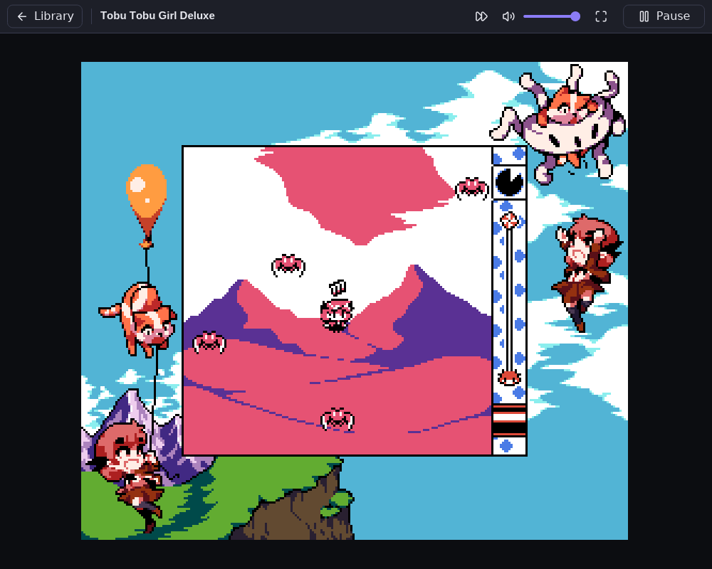

## Download

The [download page](https://mschoenm.github.io/nubo/download/) offers the right file for your computer. Or pick one here:

| Platform | Download |
| -------- | -------- |
| Windows | [Installer](https://github.com/mschoenm/nubo/releases/latest/download/Nubo-windows-x64.msi) · [Zip](https://github.com/mschoenm/nubo/releases/latest/download/Nubo-windows-x64.zip) (runs without installing) |
| Linux | [Flatpak for x86_64](https://github.com/mschoenm/nubo/releases/latest/download/Nubo-linux-x86_64.flatpak) (most PCs) · [Flatpak for ARM](https://github.com/mschoenm/nubo/releases/latest/download/Nubo-linux-aarch64.flatpak) |
| Browser | [Play in your browser](https://mschoenm.github.io/nubo/), nothing to install |
| RetroArch | The core for Windows, Linux and macOS is in each [release](https://github.com/mschoenm/nubo/releases/latest) ([how to install it](#retroarch-core)) |
| macOS | No app download yet: [build it yourself](BUILDING.md#macos), or use the RetroArch core |

- **Windows:** the files aren't signed yet, so SmartScreen may warn you the first time. Choose More info, then Run anyway.
- **Linux:** open the `.flatpak` file with your software center, or run `flatpak install --user Nubo-linux-x86_64.flatpak` (`Nubo-linux-aarch64.flatpak` on ARM). Flatpak fetches the runtime Nubo needs from Flathub the first time.
- **Browser:** has what the desktop app has: the library, save states, cheats, screenshots (as downloads) and box art. Browsers have no game folders, so you add games (or open one) and Nubo keeps them in the browser, with their saves, until you remove them from the library. Clearing the site's data in your browser deletes them.
- **New versions:** the desktop app can tell you when a new version is out, and take you to the download for your computer. It asks first, since it looks on GitHub.
- **Nightly build:** the [nightly build](https://github.com/mschoenm/nubo/releases/tag/nightly) has the newest changes that passed every check.

## Features

- **Models:** the original Game Boy, the Game Boy Pocket, the Super Game Boy 1 and 2, every revision of the Game Boy Color, and the Game Boy Advance playing Game Boy games. Nubo picks a model for each game, the Super Game Boy for games made for it. You can choose another in the settings, console first and then its revision, or for one game from its menu in the library.
- **Super Game Boy:** games made for it show their own colors and border, and games for several players can be played by up to four, each on their own controller. The pause menu lets you pick other colors, your own included, and another border. Nubo's own border, with its cloud peeking over the screen, shows a night sky or a day sky by your clock.
- **Library:** built from your game folders (in the browser, the games you add), with each game's title screen or box art, search, sorting by name or by when you played or added a game, and a Continue playing row with the games you played last. Each game has a menu (right click it) to pick the model it starts on, open its folder (in the browser, remove it) or delete its save states.
- **Saves:** save states with a picture, quick save and quick load, and continuing games where you left off. Loading a state, restarting a game or saving over a slot can be undone from the message that confirms it. In-game saves are plain `.sav` files that move between the app and the [RetroArch core](#retroarch-core).
- **Controls:** keyboard and controller, with buttons you can change and menus that work with a controller. Rewind (hold R) to go back a few seconds, fast forward, fullscreen and screenshots.
- **Colors:** gray, green or Pocket screens for Game Boy games, an original screen look, on by default, with Game Boy Color colors as soft as its own screen showed them and the original Game Boy's slow screen, which smooths out the flicker games use for see-through sprites, Super Game Boy palettes with an editor for your own, and light and dark themes that can follow your system.
- **Cheats:** GameShark and Game Genie codes, kept for each game. A cheat that needs several codes takes them all at once.
- **Cartridges:** the cartridge types almost all games use: cartridges without a mapper, MBC1, MBC2, MBC3 with its clock (as in Pokémon Gold, Silver and Crystal, including the larger MBC30 of the Japanese Crystal), MBC5 and HuC1. Games load from `.gb`, `.gbc` and `.zip` files.

<table>
  <tr>
    <td align="center">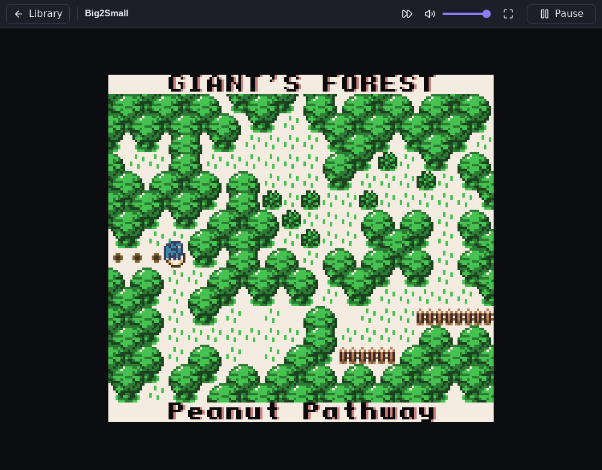 Big2Small, a Game Boy Color puzzle adventure</td>
    <td align="center">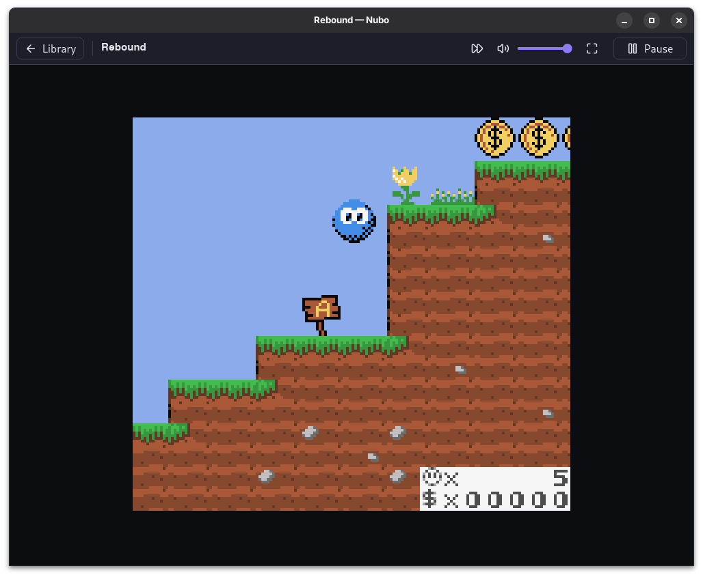 Rebound, a Game Boy Color platformer</td>
  </tr>
  <tr>
    <td align="center">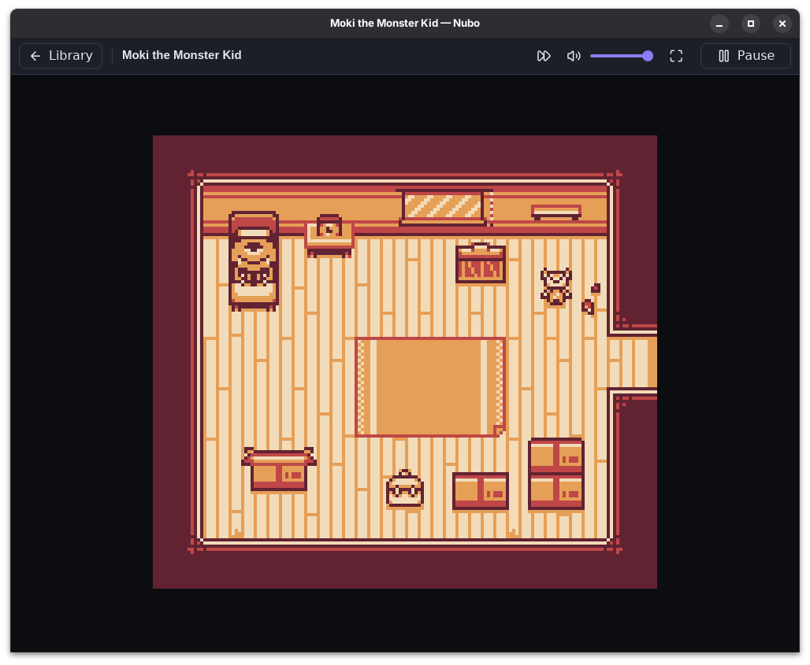 Moki the Monster Kid, a Game Boy Color adventure</td>
    <td align="center">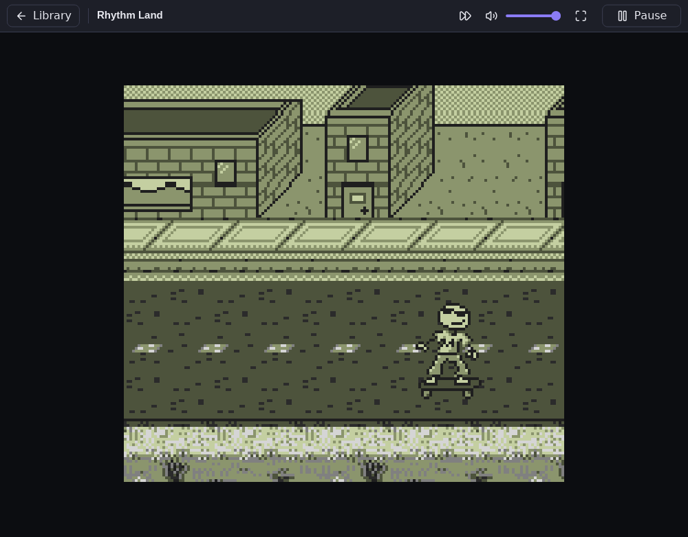 Rhythm Land, a Game Boy game, in Pocket colors</td>
  </tr>
  <tr>
    <td align="center">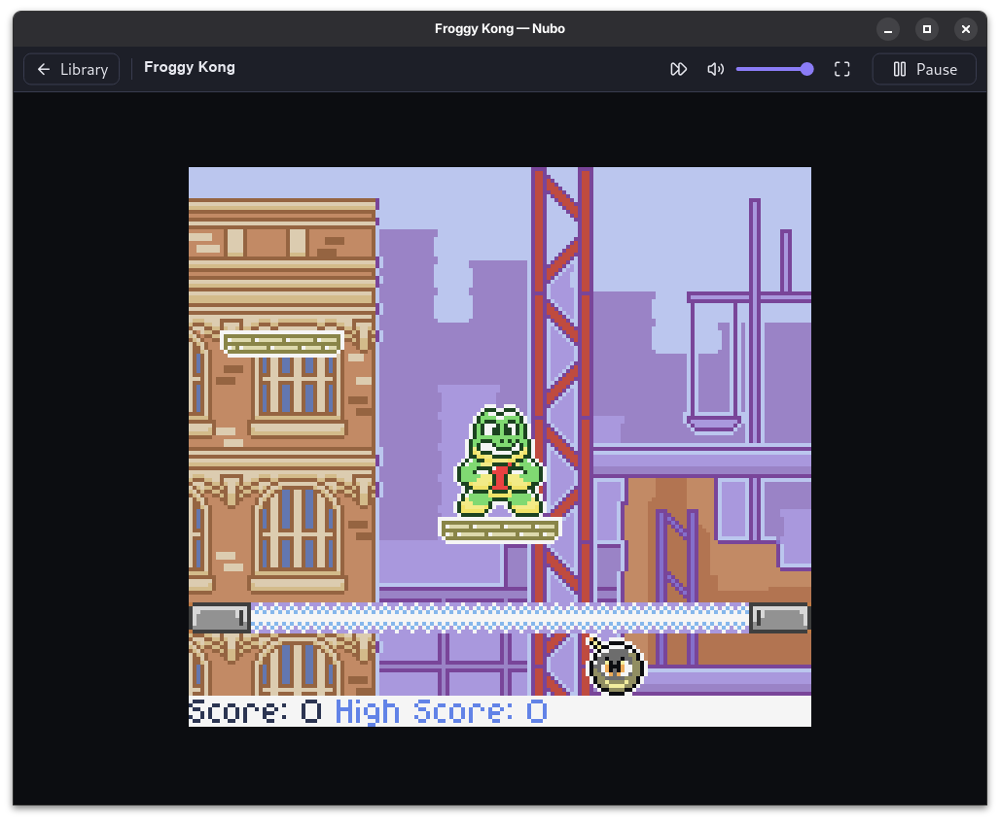 Froggy Kong, a Game Boy Color climbing game</td>
    <td align="center">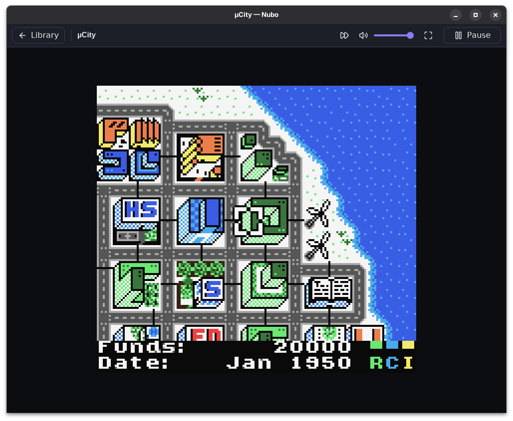 µCity, a Game Boy Color city builder</td>
  </tr>
</table>

<table>
  <tr>
    <td align="center">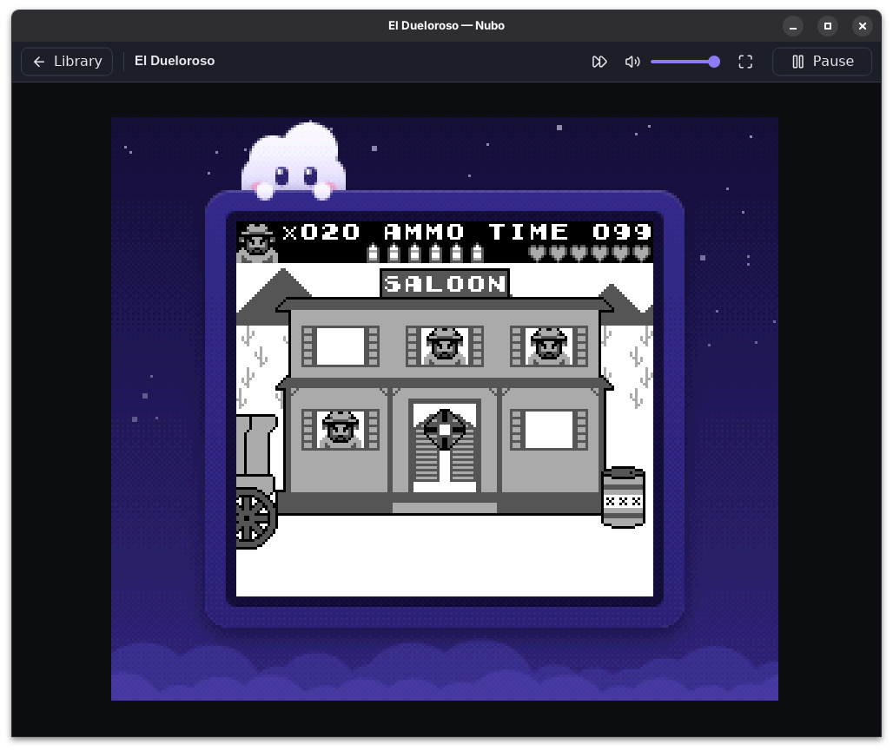 Nubo's own Super Game Boy border</td>
    <td align="center">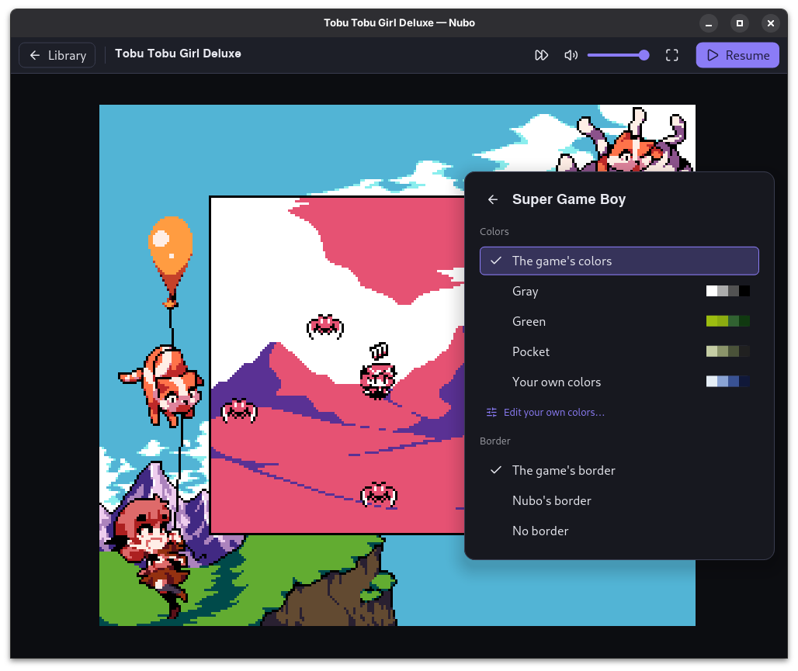 Super Game Boy colors and borders, picked while playing</td>
  </tr>
</table>

  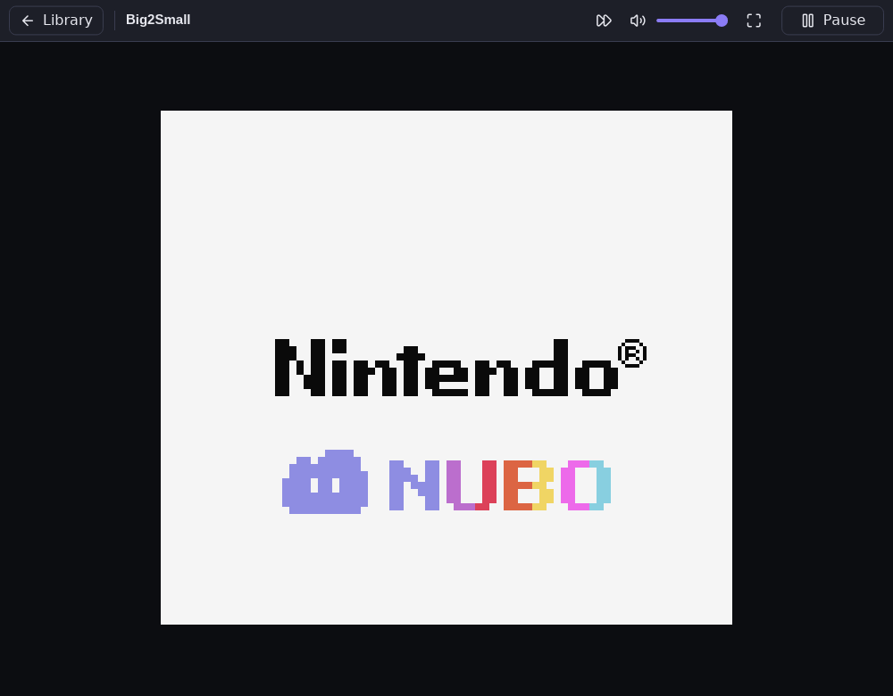 
  The Game Boy Color starting up, with Nubo's own boot screen

  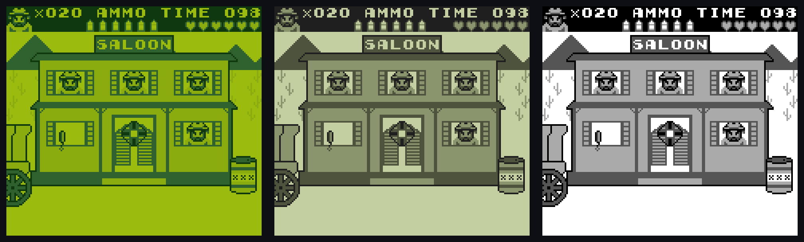 
  A Game Boy game in Nubo's green, Pocket and gray screens

  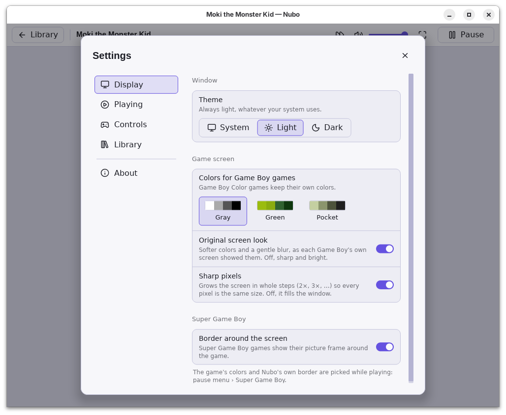 
  The Display settings

## Getting Started

Nubo doesn't come with any games. Use games you own, or free homebrew games such as [Tobu Tobu Girl Deluxe](https://tangramgames.itch.io/tobu-tobu-girl-deluxe), [µCity](https://github.com/AntonioND/ucity) or the ones on [Homebrew Hub](https://hh.gbdev.io).

Open a game with Open game in the library (Ctrl+O) or by dropping a `.gb`, `.gbc` or `.zip` file onto the window. To fill the library, add your game folders with Add games folder on the first screen or under Settings > Library:

  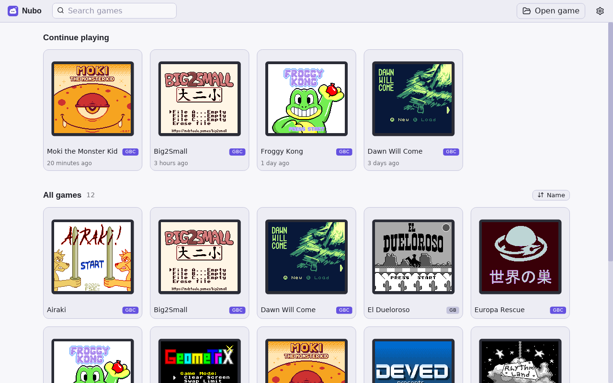

These are the default keys. All of them but Esc can be changed under Settings > Controls.

| Keyboard | Game Boy |
| -------- | -------- |
| Arrow keys | D-pad |
| Z | A |
| X | B |
| Enter | Start |
| Space | Select |

| Keyboard | Does |
| -------- | ---- |
| Esc | Pause menu |
| Tab (hold) | Fast forward |
| R (hold) | Rewind |
| F5 / F8 | Quick save / quick load |
| F11 | Fullscreen |
| F12 | Screenshot |

While a game runs, the Library button at the top left takes you back to your games, and Pause at the top right opens the pause menu. Ctrl+O opens a game, Ctrl+P pauses and resumes, Ctrl+R restarts the game and Ctrl+, opens the settings (⌘ instead of Ctrl on macOS). Except on macOS, if you bind Ctrl to a Game Boy button, these shortcuts wait until the game is paused, so holding Ctrl never gets in the way of the other keys. Double-clicking the game screen switches between fullscreen and a window (a game played fullscreen goes back to a window when you return to the library, which has its own Exit fullscreen button), and right-clicking it opens the pause menu, which a click on the game outside it closes again.

On a controller, the D-pad or left stick moves, and A and B sit where they are on a Game Boy: the right face button (B on Xbox, ○ on PlayStation) is A, and the bottom one (A on Xbox, ✕ on PlayStation) is B. L1 opens the pause menu (where you save and load states), holding R1 rewinds and holding R2 fast forwards. The other two face buttons and L2 do nothing until you give them an action in the settings. The pause menu can move to another button but always keeps one.

The menus always work the same, whatever you bind: the arrow keys, D-pad or left stick move, Enter, Space or the right face button (B on Xbox, ○ on PlayStation) picks, and Esc, Backspace or the bottom face button (A on Xbox, ✕ on PlayStation) goes back, as on Nintendo's consoles. If you'd rather pick with the bottom button and go back with the right one, as on Xbox and PlayStation, choose Xbox under Menus in the controller's settings. On a game in the library, Select, the context menu key or Shift+F10 opens its menu.

  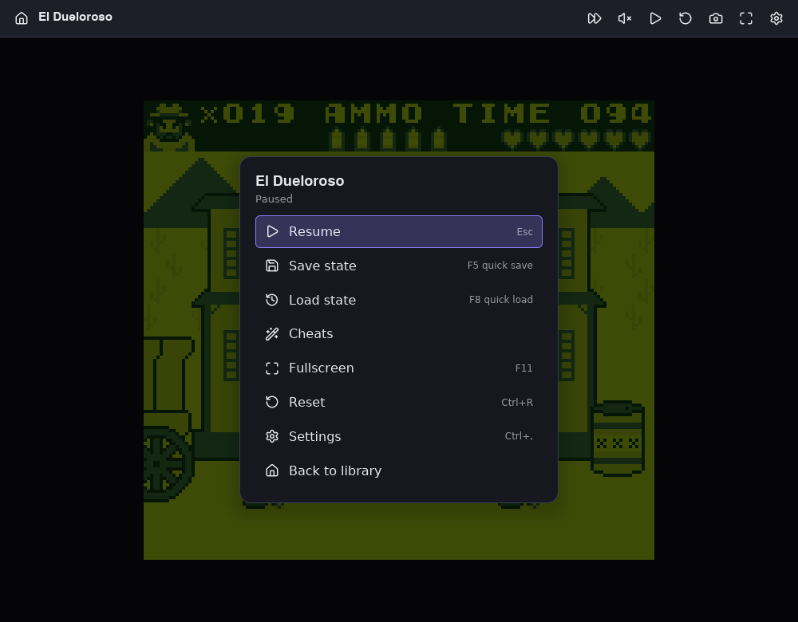 
  The pause menu, with save states, cheats, screenshots and the settings

<strong>Where your saves are</strong>

Everything Nubo keeps (settings, the library, in-game saves, save states, cheats and their pictures) is in your user data folder:

| System | Folder |
| ------ | ------ |
| Windows | `%APPDATA%\Nubo` |
| macOS | `~/Library/Application Support/Nubo` |
| Linux (Flatpak) | `~/.var/app/io.github.mschoenm.nubo/` |
| Linux (built yourself) | `~/.local/share/nubo` (or `$XDG_DATA_HOME/nubo`), with the settings in `~/.config/nubo` |

Screenshots go to your Pictures folder, in `Pictures/Nubo`.

<strong>Installing, updating and removing</strong>

- **Windows:** the installer installs Nubo for your user, without administrator rights, with a Start menu entry; it can also offer Nubo for opening `.gb` and `.gbc` files and add a desktop shortcut. Running a newer installer updates Nubo and keeps those choices. Uninstall Nubo from Settings > Apps, like any app. To install without questions from a script, run `msiexec /i Nubo-windows-x64.msi /qn`, adding `ASSOCIATE_FILES=0` (don't offer Nubo for ROMs) or `DESKTOP_SHORTCUT=1` (add a desktop shortcut); `/passive` shows only a progress bar.
- **Linux:** the Flatpak adds Nubo to your app grid; it can read game folders in your home folder and on external drives. Start it from a terminal with `flatpak run io.github.mschoenm.nubo`. To update, install the newer file over the old one with `flatpak install --user --reinstall Nubo-linux-x86_64.flatpak` (`Nubo-linux-aarch64.flatpak` on ARM); your saves and settings stay. Remove Nubo with `flatpak uninstall --user io.github.mschoenm.nubo` or your software center.

## Not Supported Yet

- A download of the app for macOS (you can [build it](BUILDING.md#macos)), and Android or iOS.
- Linking two games with the link cable.
- Rumble in the desktop app and the browser (the [RetroArch core](#retroarch-core) has it).
- The Pocket Camera, and the cartridges with an MBC6, MBC7 (Kirby Tilt 'n' Tumble), MMM01, HuC3 or TAMA5.

## Accuracy

Every change to Nubo is tested against thousands of test ROMs: small programs that each check one detail of the hardware against what real consoles do. Every pull request runs them all, and fails if a test that passed stops passing.

- **The test ROM suites:** 6,793 of 6,824 test runs pass, each test on the models it was written for, across the 12 models Nubo emulates. The suites include Blargg's tests, Mooneye, the acid tests, SameSuite, Mealybug Tearoom and Gambatte's.
- **The processor:** all [JSON CPU tests](https://github.com/adtennant/GameboyCPUTests) pass, which check every instruction cycle by cycle, except STOP, HALT, DI and EI, which the test ROMs check.
- **Speed:** being exact costs speed, but on one core of a shared 2.1 GHz cloud server Nubo still runs games about 50 to 155 times as fast as a real Game Boy, so playing at normal speed takes only a small share of one processor core.

[The results suite by suite](docs/ACCURACY.md) and [the tests that still fail, and why](tools/nubo-test-rom-runner/FAILING_TESTS.md).

## RetroArch Core

Nubo also runs in [RetroArch](https://www.retroarch.com/) as a core, with what RetroArch adds: rewind, run-ahead, netplay, shaders, RetroAchievements and recording. The boot ROMs are built in, so no BIOS files are needed. The core isn't in RetroArch's core downloader yet, so it is installed by hand:

1. Download `Nubo-libretro-<system>.zip` for your system from the [latest release](https://github.com/mschoenm/nubo/releases/latest).
2. Copy the core (`nubo_libretro.so`, `.dll` or `.dylib`) into RetroArch's `cores` folder and `nubo_libretro.info` into its `info` folder. Settings > Directory in RetroArch shows where they are.
3. Load a `.gb` or `.gbc` game with Load Core > Nubo.

[More about the core](docs/RETROARCH.md): its options, saves that move between it and the app, netplay with clock games, and the systems it runs on.

## Help and Feedback

If a game doesn't play correctly or something else is wrong, [open an issue](https://github.com/mschoenm/nubo/issues) with the game's name, the Nubo version (Settings > About), your system and, if you chose one, the Game Boy model you played it on.

## Building and Contributing

Nubo is written in Rust, with no `unsafe` code outside the RetroArch core's C interface. The app is built with [Iced](https://iced.rs), a user interface library written in Rust, and the same app compiles to WebAssembly to run in the browser.

With a [Rust toolchain](https://rustup.rs) installed (plus `pkg-config` and the ALSA and udev development files on Linux), `cargo play` builds and runs the desktop app, and `cargo xtask web` the browser version. [BUILDING.md](BUILDING.md) has the other commands, the packages, the tests and a map of the code. Pull requests are welcome; [AGENTS.md](AGENTS.md) has the project's rules and the checks to run before you push.

## Credits

Nubo started as a fork of [RetroBoy](https://github.com/smparsons/retroboy) by Samuel Parsons, who wrote the original emulator, its web frontend and its logo ([play the original](https://smparsons.github.io/retroboy)). Nubo builds on that work.

Much of its accuracy comes from other people's research and code:

- [SameBoy](https://github.com/LIJI32/SameBoy) by Lior Halphon: the APU channel timing, the mode 3 pixel pipeline, the OAM corruption bug, the OAM DMA bus conflicts, the CGB speed switch timing, STOP mode, the PPU register write timing, the serial clock, the MBC3's banks and clock latch and the Super Game Boy's commands, colors, borders and multiplayer reads are ported from SameBoy, and the Game Boy Color boot ROM is a modified version of SameBoy's (Expat License, see [NOTICE](NOTICE)). SameBoy was also the reference for halt timing, the order of the hardware models, GameShark codes and many smaller hardware quirks.
- [Bootix](https://github.com/Hacktix/Bootix) by Hacktix: the boot ROM of the monochrome models is a modified version of Bootix (CC0).
- [hardware.inc](https://github.com/gbdev/hardware.inc) by the gbdev community: the names of the hardware registers in the boot ROMs' sources (CC0).
- [Gambatte](https://github.com/pokemon-speedrunning/gambatte-core) by sinamas: the reference for much of Nubo's timing where test ROMs leave gaps: double speed, the window, the STAT and LY=LYC interrupts, the speed switch's pauses, TIMA's jump ahead, HDMA and the sound channels' sweep and envelope. It was worked out by running the same test ROMs in Gambatte and Nubo and studying where they differ, and Gambatte's own test ROMs make up more than three quarters of the test runs Nubo checks. Gambatte's GPL-2.0-only license can't be combined with Nubo's, so no code comes from it.
- [Pan Docs](https://gbdev.io/pandocs/) and the [gbdev](https://gbdev.io) community: the reference for nearly every hardware register.
- [SonoSooS's Game Boy CPU notes](https://gist.github.com/SonoSooS/c0055300670d678b5ae8433e20bea595): the fetch, decode and execute overlap of the CPU.
- The authors of the test ROMs that keep the emulator honest, linked in [the results table](docs/ACCURACY.md#test-roms): Blargg, Joonas Javanainen (Mooneye), Wilbert Pol, Matt Currie (the acid tests and Mealybug Tearoom), Lior Halphon (SameSuite), sinamas (Gambatte), Austin Appleby (GBMicrotest), c-sp (AGE, and the [Game Boy test ROM collection](https://github.com/c-sp/game-boy-test-roms) that packages them), ax6 (rtc3test), Hacktix (Bully, Strikethrough and Scribbltests), Brian Jia (TurtleTests), Damian Yerrick (little-things-gb), Eric Kirschenmann (MBC3 Tester), daid, CasualPokePlayer and the gbdev community (the GB Emulator Shootout), and adtennant (the [JSON CPU tests](https://github.com/adtennant/GameboyCPUTests)).
- The [GB Emulator Shootout](https://github.com/gbdev/GBEmulatorShootout) by daid, CasualPokePlayer and the gbdev community: the test ROM runner's list of its tests is derived from its test lists, and its scoreboard records the results the Shootout publishes (MIT License, see [NOTICE](NOTICE)).

The work on Nubo's speed drew on ideas from other emulators. [Clean-room reports](docs/speed-research) describe how they get their speed, and the shortcuts that work added, such as drawing runs of plain tiles in one go, were written from those reports alone, so no code comes from them: [Gambatte](https://github.com/pokemon-speedrunning/gambatte-core) by sinamas, [mGBA](https://github.com/mgba-emu/mgba) by endrift, [bsnes](https://github.com/bsnes-emu/bsnes) by Near, [ares](https://github.com/ares-emulator/ares), [Mesen2](https://github.com/SourMesen/Mesen2) by Sour, [Nestopia UE](https://github.com/0ldsk00l/nestopia), [Genesis Plus GX](https://github.com/ekeeke/Genesis-Plus-GX) by Eke-Eke and [BlastEm](https://www.retrodev.com/blastem/) by Mike Pavone.

<strong>The fonts, icons, box art and the games in the screenshots</strong>

- [Fira Sans](https://github.com/mozilla/Fira): the web version's font, bundled by Iced (SIL Open Font License; see [NOTICE](NOTICE)). The desktop app uses the system's own font; on Linux, the one picked for the desktop.
- The [libretro thumbnail collection](https://github.com/libretro-thumbnails/libretro-thumbnails) and the No-Intro game lists of the [libretro database](https://github.com/libretro/libretro-database): the box art the desktop app can download.
- [Lucide](https://lucide.dev): the app's icons, on the desktop and in the browser (ISC License, see [NOTICE](NOTICE)).
- [libretro.h](https://github.com/libretro/libretro-common) by the RetroArch team: the libretro API the RetroArch core's bindings are written from (MIT License, see [NOTICE](NOTICE)). [SameBoy's libretro core](https://github.com/LIJI32/SameBoy) and [rcheevos](https://github.com/RetroAchievements/rcheevos) showed how a Game Boy core lays out its memory for RetroAchievements.
- [Tobu Tobu Girl Deluxe](https://tangramgames.itch.io/tobu-tobu-girl-deluxe) by Tangram Games: the game in the Super Game Boy, pause menu and Super Game Boy menu screenshots and the Flatpak's screenshot (`images/`), and in some of the save states every version is checked against (`save-states/`), whose graphics are licensed under [CC BY 4.0](https://creativecommons.org/licenses/by/4.0/).
- The other homebrew games in the screenshots (`images/screenshots/`), each under its own license: [Big2Small](https://github.com/mdsteele/big2small) by Matthew D. Steele (GPL-3.0-or-later, also starting up in the boot screen screenshot), [Rebound](https://github.com/DevEd2/ReboundGB) by DevEd (MIT), [Moki the Monster Kid](https://github.com/sleepingpandagames/moki-the-monster-kid) by Sleeping Panda Games (MPL-2.0), [Rhythm Land](https://github.com/sinusoid-studios/rhythm-land) by Sinusoid Studios (MIT), [El Dueloroso](https://github.com/ajgalan/el-dueloroso) by Adrián JG (GPL-3.0) and [Froggy Kong](https://github.com/videogamestorytime/FroggyKong) by videogamestorytime (GPL-3.0), and in the library [Airaki](https://github.com/furrtek/Airaki) by furrtek (GPL-3.0), [Dawn Will Come](https://github.com/eishiya/DawnWillCome) by eishiya, with art by H0lyhandgrenade and eishiya and music by Kezia Salmon (code MIT, art and music [CC BY 4.0](https://creativecommons.org/licenses/by/4.0/)), [Europa Rescue](https://github.com/godai78/europa) by godai ([CC BY-SA 4.0](https://creativecommons.org/licenses/by-sa/4.0/)) and [Sushi Nights](https://github.com/Zal0/SushiNights) by Zalo, Kirblue, MaikelOrtega_ and sergiodeprado (MIT).
- [µCity](https://github.com/AntonioND/ucity) and [Geometrix](https://github.com/AntonioND/geometrix) by Antonio Niño Díaz: µCity is in a screenshot of its own and Geometrix in the library screenshot (`images/screenshots/`), and both are in the save states every version is checked against (`save-states/`), licensed under the GPL, version 3 or later.

The original project was built with the help of these resources:

1. [Gameboy CPU Manual](http://marc.rawer.de/Gameboy/Docs/GBCPUman.pdf)
2. [Pan Docs](https://gbdev.io/pandocs/)
3. [Blargg's Test ROM Collection](https://github.com/retrio/gb-test-roms)
4. [Gameboy Doctor](https://github.com/robert/gameboy-doctor)
5. [Imran Nazar's Gameboy Emulator Tutorial](https://imrannazar.com/series/gameboy-emulation-in-javascript)

## License

Nubo is free software, licensed under the [GNU General Public License, version 3](LICENSE) or (at your option) any later version. It started as a fork of RetroBoy, whose code remains available under the [Apache License 2.0](LICENSE-APACHE). The [NOTICE](NOTICE) file lists the third-party code Nubo includes and their licenses. The packages also come with `THIRD_PARTY_LICENSES.txt`, the licenses of the Rust crates Nubo is built from; keep these files with any copy you distribute.

Game Boy and Game Boy Color are trademarks of Nintendo. This project is not affiliated with or endorsed by Nintendo, and it doesn't include any Nintendo software or games.
